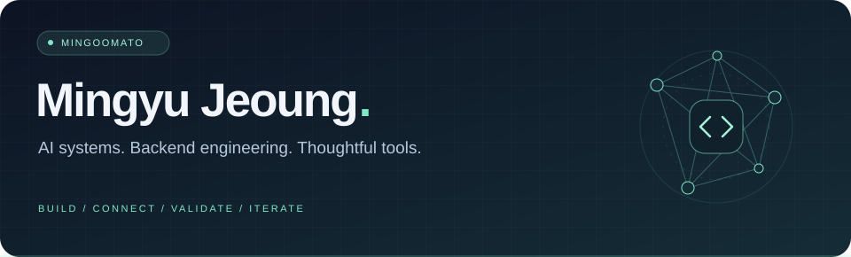
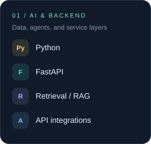
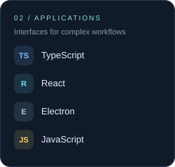
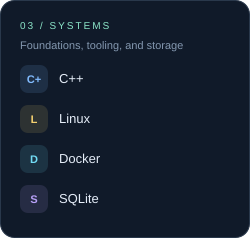

 

**Turning complex information into useful, inspectable software.**

Agentic applications &nbsp; · &nbsp; Retrieval &nbsp; · &nbsp; API integrations

[Explore projects](#selected-work) &nbsp; / &nbsp; [Tech stack](#tech-stack) &nbsp; / &nbsp; [Say hello](mailto:mj@mythimoo.com)

 

### A little about me

Hi, I'm **Mingyu** — a self-directed developer building AI systems and backend products.  
I enjoy connecting agents, data, and interfaces into workflows people can understand and verify.

**Current interests** &nbsp; Reliable LLM workflows · Evidence-aware tools · Linux systems

 

### Tech stack

Also exploring &nbsp; PyTorch · PennyLane · Firebase

 

### Selected work

<table>
<tr>
<td width="50%" valign="top">

#### 01 &nbsp; Folding-JimiJimi
**Documents → grounded answers**

A local document agent with grounded retrieval, Gemini-assisted synthesis, approval-gated edits, and Undo workflows.

TypeScript · React · Electron · FastAPI

  
<a href="https://github.com/Mingoomato/Folding-JimiJimi"><b>Explore repository ↗</b></a>

</td>
<td width="50%" valign="top">

#### 02 &nbsp; Orchestrate-the-TEAM
**Specialized agents → coordinated research**

Multi-agent orchestration with planning, ReAct/tool execution, checkpointed sessions, and artifact verification.

Python · Multi-agent systems · API integrations

  
<a href="https://github.com/Mingoomato/Orchestrate-the-TEAM"><b>Explore repository ↗</b></a>

</td>
</tr>
<tr>
<td width="50%" valign="top">

#### 03 &nbsp; ProteinScope
**Biological data → structured insight**

A protein analysis platform combining asynchronous data retrieval, typed models, literature retrieval, and SSE progress streaming.

Python · FastAPI · Async I/O · Bioinformatics

  
<a href="https://github.com/Mingoomato/ProteinScope"><b>Explore repository ↗</b></a>

</td>
<td width="50%" valign="top">

#### 04 &nbsp; Linux Endpoint Lab
**Systems concepts → hands-on experiments**

A local learning lab for durable event queues, mutual TLS, signed policies, and filesystem telemetry. Validation scope and limitations are documented in the repository.

C++20 · Linux · OpenSSL · SQLite

  
<a href="https://github.com/Mingoomato/linux-secure-endpoint-agent"><b>Explore repository ↗</b></a>

</td>
</tr>
</table>

 

### Building with others

**[Electerior / g2bmaster-frontend ↗](https://github.com/Electerior/g2bmaster-frontend)**  
Team contributions spanning notice-search consolidation, legacy URL migration, responsive tables, API integration, and frontend tests.

React · TypeScript · Vite · TanStack Query · Vitest — a team codebase; contributions describe my scope.

<b>How I work</b>

My development is extensively AI-assisted. I focus on requirements, architecture, integration, testing, debugging, and system-level iteration. The repositories and their documented validation are the reference for what is implemented.

 

---

**Let's connect.**  
[mj@mythimoo.com](mailto:mj@mythimoo.com) &nbsp; · &nbsp; [@Mingoomato](https://github.com/Mingoomato)

Build thoughtfully. Connect the pieces. Keep iterating.

