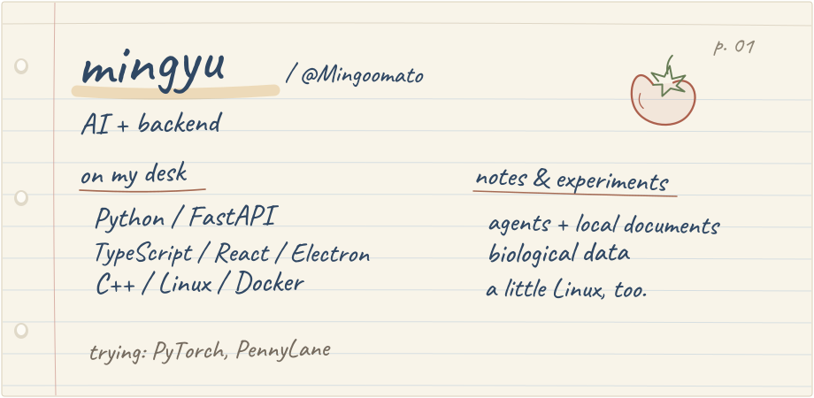

 

민규입니다. AI랑 백엔드 쪽 코드를 씁니다.  
문서를 다루는 도구, 에이전트, 생물학 데이터에 관심이 있어요.

### 만드는 것

- [Folding-JimiJimi](https://github.com/Mingoomato/Folding-JimiJimi)  
  로컬 문서를 찾아보고, 근거를 붙여 답하고, 수정하는 앱.  
  TypeScript · React · Electron · Python · FastAPI

- [Orchestrate-the-TEAM](https://github.com/Mingoomato/Orchestrate-the-TEAM)  
  여러 에이전트가 연구 작업을 나눠서 하도록 만든 도구.  
  Python · Gemini · ReAct

### 연구 / 메모

- [ProteinScope](https://github.com/Mingoomato/ProteinScope)  
  여기저기 흩어진 단백질 데이터를 모아서 살펴보는 도구.  
  Python · FastAPI · 생물학 데이터

- [LLMWiki](https://github.com/Mingoomato/FOLDING_LLMWIKI_Technical)  
  로컬 지식 도구의 설계와 평가 방법을 적어둔 곳. 구현 앱은 위의 Folding-JimiJimi.  
  설계 문서 · 평가 프로토콜 · 참조 구현

### Linux 연습장

C++이랑 Linux를 공부하면서 만든 작은 실습들.

[파일 무결성](https://github.com/Mingoomato/linux-file-integrity-monitor) ·
[커널 드라이버](https://github.com/Mingoomato/linux-kernel-driver-lab) ·
[엔드포인트 에이전트](https://github.com/Mingoomato/linux-secure-endpoint-agent) ·
[행위 탐지](https://github.com/Mingoomato/linux-behavior-detector) ·
[복구](https://github.com/Mingoomato/linux-secure-recovery) ·
[디렉터리 보호](https://github.com/Mingoomato/linux-protected-directory-guard)

### 같이 한 일

[Electerior / g2bmaster-frontend](https://github.com/Electerior/g2bmaster-frontend)  
팀 프로젝트에서 검색, API 연동, 반응형 테이블, 프론트엔드 테스트 작업에 참여했습니다.

작업 방식 메모

AI 도구를 많이 씁니다. 요구사항을 정리하고, 구조를 잡고, 연결하고, 테스트하고, 고치는 쪽에 집중합니다.  
구현한 범위와 확인한 내용은 각 레포에 적어두고 있습니다.

 

[mj@mythimoo.com](mailto:mj@mythimoo.com)
